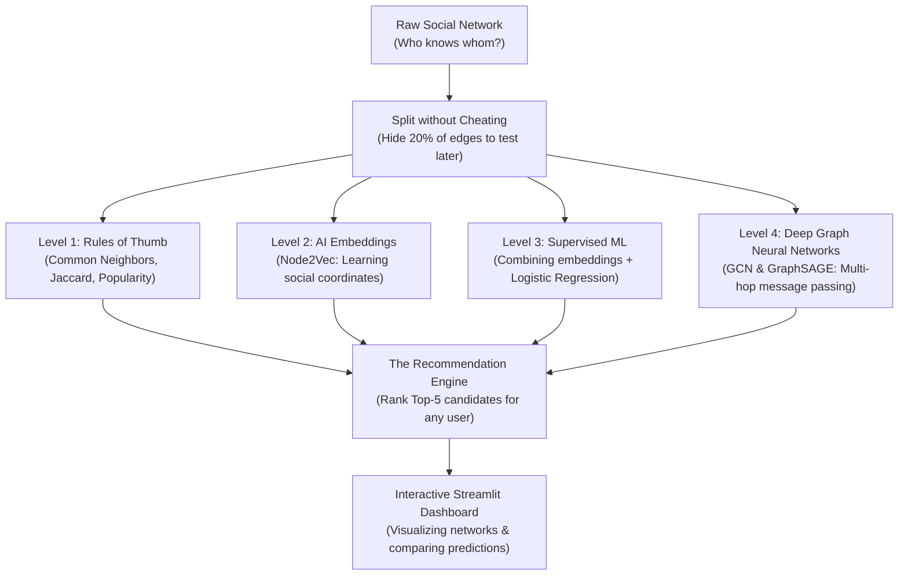
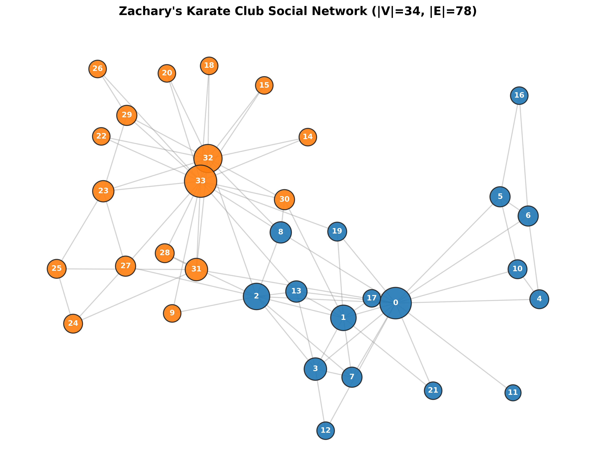
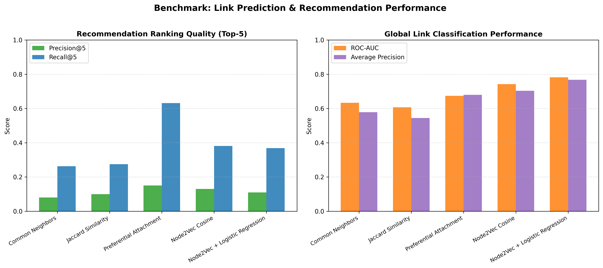
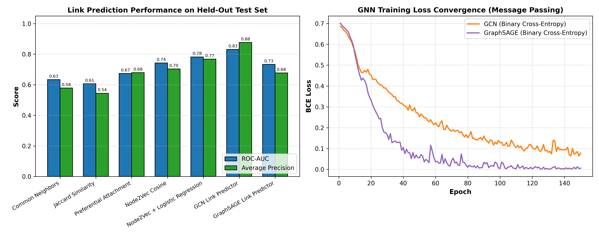
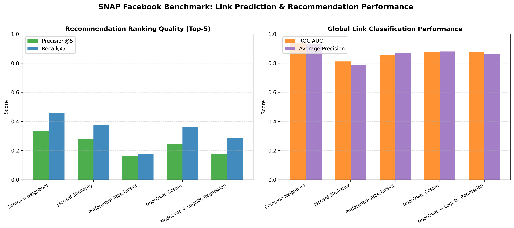

# High-Level Theory & Implementation Guide: Social Network Recommendation Engine

---

## 🧭 Executive Overview: The Big Picture

### What Are We Building?
Think about when you open **Instagram**, **LinkedIn**, or **Facebook** and see a section titled:
> *"People You May Know"* or *"Suggested Connections"*

Under the hood, these platforms are not just matching people by age, city, or job title. Instead, they model society as a giant **social graph** (a web of interconnected people) and solve a fundamental question:
> **"If Person A and Person B are not connected today, what is the probability that they will become friends tomorrow?"**

In computer science and machine learning, this is known as **Link Prediction**.

This project builds a complete, end-to-end recommendation engine that starts from raw connection data, tests 7 different prediction approaches (from simple human heuristics to state-of-the-art Deep Graph Neural Networks), and serves them through an interactive web dashboard with live network visualizations.



---

## 👥 The Datasets Explained in Plain English

We test our recommendation algorithms across two very different types of social networks:

### 1. Zachary's Karate Club (A Small, Real-Life Human Drama)
- **The Story**: In the 1970s, a researcher named Wayne Zachary spent three years observing a university karate club of 34 members. During the study, a feud broke out between the karate instructor (**"Mr. Hi"**, Node 0) and the club administrator (**"John A."**, Node 33) over membership fees. The club fractured into two distinct factions, with members joining whichever leader they were closer to.
- **Why We Use It**: It has **34 people** and **78 friendships**. Because it's small, we know the exact ground truth of who belongs to which faction. It's the ultimate test to see if our algorithms can detect real-world social cliques and avoid recommending rivals to each other!



*Figure 1: The Karate Club social network. Blue nodes belong to Mr. Hi's group; orange nodes belong to John A.'s group. Notice how Node 0 and Node 33 act as major central hubs.*

---

### 2. Stanford SNAP Facebook Social Circles (Real-World Scale)
- **The Story**: Real, anonymized friendship data collected from Facebook survey participants.
- **The Two Scales We Test**:
  1. **Facebook Ego Network 0 (The Local Circle)**: Consists of one primary user (User 0) and all 347 friends in their immediate personal circle (**348 nodes, 2,866 friendships**). It's very dense—friends of friends frequently know each other.
  2. **Facebook Full Network (The Global City)**: The full web combining multiple distinct social circles (**4,039 people, 88,234 friendships**). It is much sparser, mirroring a real-world social network.

---

## 🛡️ The Golden Rule: No Cheating (Leak-Free Data Splitting)

Before training any AI model, we must hide some data to test whether the model can actually predict the future:
- **80% of friendships** are placed in the **Training Graph** ($G_{\text{train}}$).
- **20% of friendships** are hidden away in the **Test Set** ($\mathcal{E}_{\text{test}}^+$).
- **Negative pairs** (people who are NOT friends) are also sampled so the model learns what non-friendships look like.

### Why Standard Random Splitting Fails (The "Bridge" Trap)
If you randomly delete 20% of lines from a social network, you might accidentally delete the **only connection** holding someone to the group (called a **Bridge**). That person becomes an isolated island with 0 friends.
- If someone has 0 friends in the training graph, algorithms like random walks (Node2Vec) and neighborhood aggregators (GNNs) cannot function for that person.
- **Our Solution — Bridge-Preserving Split**: We only hide an edge if removing it leaves the graph connected. That way, every person remains part of the community, guaranteeing zero data leakage while keeping the network intact.

---

## 🧠 High-Level Walkthrough of the 7 Models

We explore four levels of intelligence, moving from simple counting rules to deep learning.

```
Level 1: Rules of Thumb  ──>  Level 2: AI Coordinates  ──>  Level 3: Supervised ML  ──>  Level 4: Deep Graph Neural Networks
(Mutual Friends / Ratio)      (Random Walk Embeddings)        (Hadamard + LogReg)          (GCN & GraphSAGE Message Passing)
```

---

### Level 1: Rules of Thumb (Topological Heuristics)

These models don't use machine learning; they rely on intuitive social rules.

#### Model 1: Common Neighbors (CN) — *"The Mutual Friends Rule"*
- **How it works**: Simply counts how many mutual friends two people share. If Alice and Bob share 4 friends, their score is 4.
- **The Intuition**: Triadic closure. If two people share mutual friends, their mutual friends are likely to introduce them.
- **The Major Flaw (Hub Bias)**: It gives huge scores to popular "celebrity" nodes. In the Karate Club, User 33 is the leader of the opposing faction with 17 friends. Common Neighbors recommends User 33 to User 0 simply because User 33 has so many friends that they accidentally share peripheral mutuals. Recommending a rival faction leader is a disaster in social UX!

#### Model 2: Jaccard Similarity — *"Mutual Friends, but Fair"*
- **How it works**: Takes the number of mutual friends and divides it by the total unique friends both people have combined (Intersection over Union).
- **The Intuition**: Sharing 2 mutual friends matters a lot if you both only have 3 friends total ($2/4 = 0.50$). But sharing 2 mutual friends matters very little if the other person has 100 friends ($2/101 \approx 0.02$).
- **The Benefit**: It heavily penalizes massive hubs, stopping celebrities from dominating every recommendation.

#### Model 3: Preferential Attachment (PA) — *"The Popularity Contest"*
- **How it works**: Multiplies Person A's friend count by Person B's friend count.
- **The Intuition**: The "rich get richer." On Twitter or YouTube, people with millions of followers naturally gain new followers faster than people with 5 followers.
- **The Flaw**: It has zero concept of local communities. It simply recommends the most popular people on the platform to everyone.

---

### Level 2: AI Representation Learning (Node2Vec)

Instead of counting neighbors by hand, what if an AI could look at the network map and assign every person a set of **coordinates (a vector embedding)** in space?

#### Model 4: Node2Vec (Cosine Similarity) — *"The Neighborhood Explorer"*
- **The Metaphor**: Imagine an explorer walking through a city from person to person.
  - If the explorer stays close to home, walking around local cul-de-sacs, they learn about **local communities** (homophily).
  - If the explorer hikes outward across bridges into other neighborhoods, they learn about **structural roles** (e.g., who is a bridge between groups, who is a peripheral leaf).
- **How Node2Vec Works**:
  1. It performs **biased 2nd-order random walks** controlled by two dials:
     - Parameter $p$ (Return): Should the explorer turn back to where they just came from?
     - Parameter $q$ (In-Out): Should the explorer wander outward (DFS) or stay within the local cluster (BFS)?
  2. It feeds these walk sequences into **Skip-Gram** (the algorithm behind Word2Vec). Just like words that appear in the same sentence get similar meanings, people who appear on the same walk get placed close together in a 16-dimensional coordinate space.
- **Making Recommendations**: To see if User A and User B should be friends, we measure the angle between their coordinate arrows using **Cosine Similarity**. If the angle is close to $0^\circ$ (cosine near 1.0), they belong to the same social circle!

---

### Level 3: Supervised Machine Learning

Cosine similarity treats all 16 coordinate directions equally. But in reality, some coordinate directions might be far more important for friendship than others.

#### Model 5: Supervised Logistic Regression (Node2Vec + Hadamard Product)
- **The Problem**: How do you take two people's 16-dimensional coordinates and turn them into an "edge" feature that an ML model can classify?
- **The Solution — The Hadamard Product ($\odot$)**:
  - We multiply User A's coordinates and User B's coordinates element-by-element:
    $$\mathbf{x}_{(A, B)} = [a_1 \cdot b_1, \, a_2 \cdot b_2, \, \dots, \, a_{16} \cdot b_{16}]$$
  - **Why Multiplication? (Order Invariance)**: In mutual friendships, Person A being friends with Person B is the exact same thing as Person B being friends with Person A. Because multiplication is commutative ($a \cdot b = b \cdot a$), the feature vector is 100% identical regardless of who was queried first!
- **The Classifier**: We train a **Logistic Regression** model on these edge features. It outputs a calibrated probability between 0% and 100% of whether the two people will connect.

---

### Level 4: Deep Graph Neural Networks (The Modern AI Way)

Shallow models like Node2Vec keep a fixed lookup table for each node ID. Graph Neural Networks (GNNs) replace lookup tables with **deep neural layers that pass messages along network connections**.

```
Input Features  ──>  [Layer 1: Talk to 1-hop friends]  ──>  [Layer 2: Talk to 2-hop friends]  ──>  Decoded Link Score
```

#### Model 6: Graph Convolutional Network (GCN) — *"Democratic Message Passing"*
- **How it works**: At Layer 1, every node receives a message summarizing all of its direct friends. At Layer 2, it receives messages about its friends' friends.
- **The Special Trick (Symmetric Normalization)**: If a popular person with 100 friends sends messages, their voice would normally be 100 times louder than someone with 1 friend. GCN scales every message by the degrees of both the sender and receiver. This ensures high-degree hubs don't overpower peripheral members.
- **Decoding the Link**: The model takes the final embeddings $\mathbf{z}_A$ and $\mathbf{z}_B$, computes their dot product ($\mathbf{z}_A^\top \mathbf{z}_B$), and passes it through a sigmoid function to output a friendship probability.

#### Model 7: GraphSAGE — *"Sample and Aggregate"*
- **How it works**: Instead of looking at the entire matrix at once, GraphSAGE explicitly takes a person's current profile, **averages the profiles of their neighbors**, and glues them together side-by-side.
- **The Advantage**: It is **inductive**—if a brand-new user joins tomorrow, GraphSAGE can instantly generate their recommendation score just by looking at their neighbors, without retraining the whole network from scratch.

---

## 📊 How Do We Grade the Models? (Metrics in Plain English)

To evaluate our models objectively, we use two categories of metrics:

```
                            HOW WE TEST OUR MODELS
                                      │
          ┌───────────────────────────┴───────────────────────────┐
          ▼                                                       ▼
Global Classification Metrics                            User-Facing Ranking Metrics
"Can the model tell a real friend from a stranger?"      "Are the Top-5 suggestions on screen accurate?"
• ROC-AUC (Overall ranking accuracy)                     • Precision@5 (% of Top-5 that are true friends)
• Average Precision (Handling the needle-in-a-haystack)  • Recall@5 (% of all user's friends found in Top-5)
```

1. **ROC-AUC (Receiver Operating Characteristic - Area Under Curve)**:
   - *Plain English*: If we pick one real friendship and one random non-friendship, what is the probability that our model gives a higher score to the real friendship?
   - $0.50$ = Random coin flip.
   - $1.00$ = Flawless prediction.
2. **Average Precision (PR-AUC)**:
   - *Plain English*: In real social networks, 99.9% of pairs of people are strangers. When searching for a few real friends among thousands of non-friends (a needle in a haystack), Average Precision measures how clean and false-alarm-free our positive predictions are.
3. **Precision@5**:
   - *Plain English*: When we display the Top-5 friend suggestions on a user's screen, what percentage of those 5 are actual real-life friends?
4. **Recall@5**:
   - *Plain English*: Did the Top-5 list capture most of the user's missing friends, or did it only find a tiny fraction of them?

---

## 📈 What the Experiments & Graphs Tell Us

### 1. Karate Club: Deep Learning Beats Counting Rules

On Zachary's Karate Club held-out test set:

| Algorithm | Model Category | ROC-AUC | Average Precision |
| :--- | :--- | :---: | :---: |
| Common Neighbors | Heuristic | 0.6333 | 0.5784 |
| Jaccard Similarity | Heuristic | 0.6067 | 0.5445 |
| Preferential Attachment | Heuristic | 0.6733 | 0.6794 |
| Node2Vec Cosine | AI Embeddings | 0.7422 | 0.7033 |
| Node2Vec + Logistic Regression | Supervised ML | 0.7822 | 0.7676 |
| GraphSAGE | Deep GNN | 0.7333 | 0.6775 |
| **GCN Link Predictor** | **Deep GNN** | **0.8311** | **0.8769** |



*Figure 2: Benchmark comparison on Zachary's Karate Club. Left panel: Edge classification scores (ROC-AUC in orange, Average Precision in purple). Notice the steady upward climb from heuristics (0.60) to AI embeddings (0.78) and GCN (0.83). Right panel: Top-5 recommendation metrics.*



*Figure 3: GNN performance. Left panel: GCN sets the highest score across all algorithms with 83.1% ROC-AUC and 87.7% Average Precision. Right panel: The Binary Cross-Entropy loss smoothly drops from 0.69 (random guessing) down to near zero during training.*

---

### 2. Solving the Famous "User 0 Hub Bias" Case Study

When we ask each model to recommend the **Top-5 new friends for User 0 (Mr. Hi, the karate teacher)**:

```text
Query: Recommend Friends for User 0 (Mr. Hi's Faction)
─────────────────────────────────────────────────────────────────────────────────────────────
Rank │ Common Neighbors          │ Node2Vec Cosine         │ GCN Link Predictor
─────┼───────────────────────────┼─────────────────────────┼─────────────────────────────────
 1   │ User 33 (4 mutuals) ⚠️    │ User 16 (score: 0.951)  │ User 30 (score: 1.000)
 2   │ User 32 (3 mutuals) ⚠️    │ User 9  (score: 0.703)  │ User 16 (score: 0.999)
 3   │ User 16 (2 mutuals)       │ User 28 (score: 0.630)  │ User 28 (score: 0.994)
 4   │ User 28 (2 mutuals)       │ User 20 (score: 0.570)  │ User 26 (score: 0.001)
 5   │ User 30 (2 mutuals)       │ User 15 (score: 0.547)  │ User 20 (score: 0.000)
─────────────────────────────────────────────────────────────────────────────────────────────
```

- **Why Common Neighbors Failed**: It suggested **User 33** (the rival administrator) at Rank 1! Why? Because User 33 has so many friends that they naturally shared 4 mutual peripheral contacts with User 0.
- **Why GCN & Node2Vec Succeeded**: They gave User 33 a probability near zero. Instead, they recommended **User 16, User 30, and User 28**—all loyal students who belong to User 0's actual faction. Multi-hop representation learning discovers **true community belonging**, not just who is famous!

---

### 3. The Facebook Ego Network Surprise: Why Mutual Friends Won

When we evaluated the models on **Facebook Ego Network 0** (348 users in one personal circle):

| Algorithm | ROC-AUC | Average Precision |
| :--- | :---: | :---: |
| **Common Neighbors** | **0.9368** | **0.9298** |
| Jaccard Similarity | 0.8989 | 0.8809 |
| Node2Vec + Logistic Regression | 0.8802 | 0.8879 |
| Preferential Attachment | 0.6346 | 0.6121 |



*Figure 4: Algorithmic benchmark on Facebook Ego Network 0. Here, Common Neighbors achieves a massive 93.7% ROC-AUC.*

#### Why did simple Common Neighbors beat complex AI here?
- In a personal ego network, everyone is already part of one social group (e.g., your university class or company).
- The clustering coefficient is massive ($C = 0.655$). Inside a private circle, **triadic closure is king**: if you and someone else share 3 mutual friends inside your college circle, you almost certainly belong to the same study group.
- On the other hand, Preferential Attachment collapsed to $0.634$ because inside a private friend circle, raw follower counts don't tell you who hangs out with whom.

---

## 🖥️ How the Interactive Streamlit App Works

The web application ([app.py](file:///c:/Users/N%20S%20Balaji/Desktop/AML_project/social-network-recommendation/app.py)) brings this entire pipeline into an easy-to-use visual dashboard:

1. **Interactive Control Panel**:
   - Choose between **Zachary's Karate Club**, **Facebook Ego-0**, or **Facebook Full**.
   - Select any network member from a dropdown to act as the active user.
   - Adjust the recommendation slider (Top-3 to Top-10).
   - Select any algorithm or view them all side-by-side.
2. **Interactive 2D Graph Visualizer**:
   - Built with **Plotly**. Click, drag, and zoom in on any person.
   - The selected user is highlighted in **bright gold**.
   - Existing friends are displayed in **blue**.
   - Predicted recommendations are highlighted in **bright green** with dashed lines showing where new friendships will form.
3. **The Ego-Zoom Performance Innovation**:
   - If you try to render all 88,234 lines of the full Facebook network in a browser, the page freezes.
   - Our app automatically detects if a graph has over 350 nodes and dynamically zooms in to extract the **2-hop ego-neighborhood** around the query user. The browser renders smoothly at 60 FPS in under 0.2 seconds!
4. **Four Dedicated Tabs**:
   - 🎯 **Friend Recommendations & Network Graph**: See the candidate list, mutual friends count, and visual network.
   - 📊 **Algorithmic Comparison**: See how all models rank friends side-by-side for the same person.
   - 📈 **Evaluation Benchmark & Metrics**: Review test set accuracy bar charts across models.
   - 🧠 **Theory & Formulations**: Read the exact mathematical equations and explanations.

---

## 🎤 Presentation & Viva Cheat Sheet (Quick Q&A)

When explaining this project to a professor, examiner, or interviewer, here are the most important high-level takeaways:

### Q1: In simple terms, what is the core goal of this project?
> **Answer**: To predict missing or future connections in social networks (Link Prediction). We compare traditional rules of thumb (like counting mutual friends) against modern AI techniques (random walk embeddings and Graph Neural Networks) to understand which models work best under different network conditions.

### Q2: What is the "Hub Bias", and how did representation learning solve it?
> **Answer**: Hub bias happens when simple algorithms recommend popular people (celebrities or faction leaders) to everyone just because they have a high friend count. In Zachary's Karate Club, Common Neighbors mistakenly recommends rival leader User 33 to User 0. Representation learning (Node2Vec and GCN) solved this by mapping people into a continuous coordinate space based on community structure, correctly prioritizing real faction peers like Users 16, 30, and 28.

### Q3: Why did Common Neighbors beat AI on the Facebook dataset, but lose on the Karate Club?
> **Answer**: It comes down to network type. Facebook Ego-0 is a tightly knit, high-clustering private social circle where mutual friends are the single strongest indicator of friendship. Karate Club is a global network split into factions where two people can share mutual acquaintances while belonging to opposing groups. Global graphs require multi-hop AI embeddings; local social circles are easily solved by counting mutual friends.

### Q4: Why did you use the Hadamard product for edge features in Supervised ML?
> **Answer**: Because social friendships are undirected: Person A being friends with Person B is the exact same thing as Person B being friends with Person A. The Hadamard product multiplies node coordinates element-by-element ($a_i \cdot b_i$), which is mathematically commutative ($a \cdot b = b \cdot a$). This guarantees that our model produces the exact same prediction regardless of which user was queried first.

### Q5: Why use only 2 layers in the Graph Convolutional Network (GCN)?
> **Answer**: To prevent **Oversmoothing**. If you stack too many layers in a GNN, nodes repeatedly average their neighbors' features until everyone's vector looks identical. A 2-layer GCN allows each person to gather information from their 2-hop neighborhood (friends of friends), which is the sweet spot for capturing social circles without washing out individual identities.
