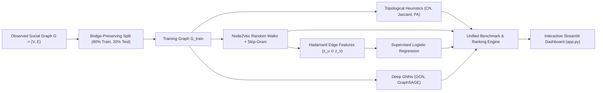
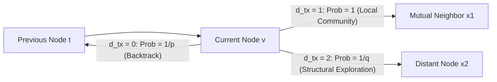

# Theoretical Foundations, Algorithmic Implementation, and Empirical Evaluation Guide
## Social Network Recommendation Engine using Graph Representation Learning and Link Prediction

---

## 1. Executive Summary & Problem Formulation

### 1.1 The Social Recommendation Problem
In social media and professional networking platforms, the core recommendation challenge is **Friend / Connection Recommendation**. Formally, this is modeled as the **Link Prediction** problem on an undirected, unweighted graph:
$$G = (V, E)$$
where:
- $V = \{v_1, v_2, \dots, v_n\}$ represents the set of social network members (nodes/users).
- $E \subseteq V \times V$ represents the set of observed friendships or social connections (edges).

Given a snapshot of the graph $G$, the goal of the recommendation engine is to estimate the probability or affinity score $\hat{S}(u, v)$ for all unobserved pairs:
$$(u, v) \in (V \times V) \setminus E \quad \text{such that } u \neq v$$
and return the ordered Top-$K$ candidates for any queried active user $u \in V$:
$$\text{Top}_K(u) = \arg\max_{v \in \mathcal{C}(u)}^{(K)} \hat{S}(u, v)$$
where $\mathcal{C}(u) = \{v \in V \mid v \neq u \text{ and } (u, v) \notin E\}$ denotes the **eligible candidate pool**.



---

### 1.2 Data Leakage Prevention: The Bridge-Preserving Edge Split
A critical flaw in naive graph machine learning is **data leakage**. If an algorithm tests link prediction on edges that were already present when calculating neighborhood heuristics, random walks, or GNN message-passing convolutions, the evaluation metrics will be artificially inflated.

Furthermore, randomly dropping $20\%$ of edges from a sparse social graph often creates **disconnected components** or isolates nodes ($d_v = 0$). When a node is isolated in $G_{\text{train}}$:
- Random walk algorithms (Node2Vec) cannot explore paths from that node.
- Degree-based heuristics collapse to zero.
- Message-passing GNNs receive no neighborhood aggregation signals.

#### Our Leak-Free Protocol:
1. **Bridge Preservation**: We shuffle all edges $\mathcal{E}$ with a fixed seed. When selecting an edge $(u, v)$ for the held-out test set $\mathcal{E}_{\text{test}}^+$, we tentatively remove it from $G_{\text{train}}$. We check whether $G_{\text{train}}$ remains connected (`nx.is_connected(g_train)`). If removing $(u, v)$ would partition the network (i.e., $(u, v)$ is a **bridge**), the edge is backtracked into $G_{\text{train}}$ and retained.
2. **Strict Training Boundary**: Node embeddings $\mathbf{z}_v$, heuristic neighborhood caches, and GNN message-passing edges (`data.edge_index`) are computed **exclusively on $G_{\text{train}}$**.
3. **Disjoint Negative Sampling**: We generate negative test pairs $\mathcal{E}_{\text{test}}^-$ from the complement graph $\bar{E} = (V \times V) \setminus E$. We enforce that $\mathcal{E}_{\text{train}}^-$ and $\mathcal{E}_{\text{test}}^-$ are strictly disjoint:
   $$\mathcal{E}_{\text{train}}^+ \cap \mathcal{E}_{\text{test}}^+ = \emptyset, \quad \mathcal{E}_{\text{train}}^- \cap \mathcal{E}_{\text{test}}^- = \emptyset, \quad (\mathcal{E}_{\text{train}}^+ \cup \mathcal{E}_{\text{test}}^+) \cap (\mathcal{E}_{\text{train}}^- \cup \mathcal{E}_{\text{test}}^-) = \emptyset$$

---

## 2. Datasets Used & Topological Provenance

The system is evaluated across two distinct scales: a classical sociological fission network and a modern real-world multi-scale ego network.

### 2.1 Zachary's Karate Club (Zachary, 1977)
- **Context**: A classic benchmark in network science capturing the interpersonal friendships among 34 members of a university karate club observed over three years. Due to an internal conflict between the club instructor ("Mr. Hi", Node 0) and the club administrator ("John A.", Node 33), the club split into two distinct factions.
- **Topological Characteristics**:
  - Number of Nodes ($|V|$): **34**
  - Number of Edges ($|E|$): **78**
  - Network Density ($\rho$): **0.1390** (13.9% of all possible pairwise links exist)
  - Average Degree ($\langle k \rangle$): **4.59** friends per member
  - Average Clustering Coefficient ($C$): **0.5706**
  - Transitivity: **0.2557**
  - Diameter: **5**


*Figure 1: Zachary's Karate Club network topology. Node colors distinguish the two post-split factions: 'Mr. Hi' (blue) and 'Officer / John A.' (orange). Node sizing corresponds directly to degree centrality. Notice the two high-degree hub nodes: Node 0 and Node 33.*

---

### 2.2 Stanford SNAP Facebook Social Circles (McAuley & Leskovec, NIPS 2012)
- **Context**: Real-world anonymized Facebook friendships collected from survey participants across 10 distinct social circles (ego networks).
- **Multi-Scale Subsets Evaluated**:
  1. **Facebook Ego Network 0 (`facebook_ego0`)**:
     - Consists of the primary survey participant (Ego User 0) and all friends in User 0's immediate social circle ($|V| = 348$, $|E| = 2,866$).
     - High density ($\rho = 0.0474$), high clustering coefficient ($C = 0.6554$), and average degree $\langle k \rangle = 16.47$.
  2. **Facebook Full Network (`facebook_full`)**:
     - The consolidated global graph combining all 10 ego networks ($|V| = 4,039$, $|E| = 88,234$).
     - Real-world power-law degree distribution, low density ($\rho = 0.0108$), average degree $\langle k \rangle = 43.69$, and clustering coefficient $C = 0.6055$.

| Topological Metric | Zachary's Karate Club | SNAP Facebook Ego-0 | SNAP Facebook Full |
| :--- | :---: | :---: | :---: |
| **Nodes ($|V|$)** | 34 | 348 | 4,039 |
| **Edges ($|E|$)** | 78 | 2,866 | 88,234 |
| **Density ($\rho$)** | **0.1390** | 0.0474 | **0.0108** |
| **Average Degree ($\langle k \rangle$)** | 4.59 | 16.47 | 43.69 |
| **Clustering Coefficient ($C$)** | 0.5706 | **0.6554** | 0.6055 |
| **Diameter** | 5 | 8 | 8 |

---

## 3. Working & Theoretical Formulation of Each Model

We implemented and benchmarked 7 algorithms across three paradigms:

```
                    LINK PREDICTION PARADIGMS
                               │
       ┌───────────────────────┼────────────────────────┐
       ▼                       ▼                        ▼
Topological Heuristics   Shallow Representations   Deep Graph Neural Networks
• Common Neighbors       • Node2Vec (Cosine)       • GCN Link Predictor
• Jaccard Coefficient    • Supervised LogReg       • GraphSAGE Link Predictor
• Preferential Attach.     (Hadamard Product)
```

---

### 3.1 Model 1: Common Neighbors (CN)
#### Intuition & Theoretical Basis
The Common Neighbors heuristic is grounded in the sociological principle of **Triadic Closure**: if node $u$ is friends with $w$, and node $v$ is friends with $w$, there is a heightened probability that $u$ and $v$ will form a connection. The shared neighbor $w$ acts as a social conduit introducing $u$ and $v$.

#### Mathematical Formulation
$$S_{\text{CN}}(u, v) = |N(u) \cap N(v)|$$
where $N(u) = \{w \in V \mid (u, w) \in E\}$ denotes the immediate 1-hop neighborhood of $u$.

#### Strengths & Fatal Flaw: The Hub Bias
- **Strength**: Computationally instantaneous ($O(|N(u)| + |N(v)|)$). Highly effective in dense ego networks where triadic closure dominates.
- **Fatal Flaw (Hub Bias)**: The metric simply sums mutual friends without normalizing for popularity. High-degree "hub" nodes (e.g., celebrities, organization leaders) have massive neighborhoods, so they naturally share mutual friends with nearly everyone. As a result, CN frequently recommends high-degree opposing faction leaders (e.g., User 33 to User 0 in the Karate Club) even when they share zero community affinity.

---

### 3.2 Model 2: Jaccard Similarity Coefficient
#### Intuition & Theoretical Basis
To counter the hub bias of Common Neighbors, the Jaccard Coefficient applies **Intersection over Union (IoU)** normalization. It evaluates the proportion of common acquaintances relative to the total combined social sphere of both users.

#### Mathematical Formulation
$$S_{\text{Jaccard}}(u, v) = \frac{|N(u) \cap N(v)|}{|N(u) \cup N(v)|} = \frac{|N(u) \cap N(v)|}{|N(u)| + |N(v)| - |N(u) \cap N(v)|}$$

#### Analysis
- If $u$ and $v$ share 2 friends out of 4 total unique acquaintances, $J(u, v) = \frac{2}{4} = 0.50$.
- If $u$ shares 2 friends with a massive hub $v$ who has 50 acquaintances, $J(u, v) = \frac{2}{50} = 0.04$.
- Jaccard successfully dampens the hub bias, but it penalizes peripheral nodes with few connections when evaluating potential friendships with moderately connected users.

---

### 3.3 Model 3: Preferential Attachment (PA)
#### Intuition & Theoretical Basis
Newman (2001) and Barabási & Albert (1999) observed that many real-world networks exhibit scale-free power-law degree distributions governed by the **"Rich-Get-Richer"** mechanism. New connections form disproportionately with nodes that already possess high degrees.

#### Mathematical Formulation
$$S_{\text{PA}}(u, v) = |N(u)| \times |N(v)| = \text{deg}(u) \times \text{deg}(v)$$

#### Analysis
- PA requires zero neighborhood intersection and evaluates solely on vertex degrees ($O(1)$ complexity).
- While predictive of global edge formation over macro-evolutionary timelines, it fails for personalized friend recommendation: it always recommends the highest-degree nodes in the entire network regardless of topological distance or community boundaries.

---

### 3.4 Model 4: Node2Vec Representation Learning
#### Intuition & Theoretical Basis
Grover & Leskovec (KDD 2016) extended Word2Vec (Skip-gram with negative sampling) to networks. Instead of sentences composed of words, Node2Vec treats **biased random walk sequences** as sentences composed of node tokens, learning a low-dimensional continuous mapping:
$$f: V \to \mathbb{R}^d$$
that maps nodes close in topological space to vectors close in Euclidean space.

#### Biased 2nd-Order Random Walk Mechanics
Given a random walk that transitioned from node $t$ to node $v$, the transition probability to step to neighbor $x \in N(v)$ is governed by:
$$\pi_{vx} = \alpha_{pq}(t, x) \cdot w_{vx}$$
where the non-normalized search bias $\alpha_{pq}(t, x)$ is parameterized by two hyperparameters:
$$\alpha_{pq}(t, x) = \begin{cases}
\frac{1}{p} & \text{if } d_{tx} = 0 \quad (\text{backtrack to previous node } t) \\
1 & \text{if } d_{tx} = 1 \quad (\text{visit a mutual neighbor of } t \text{ and } v) \\
\frac{1}{q} & \text{if } d_{tx} = 2 \text{ or } \infty \quad (\text{explore outward into new territory})
\end{cases}$$



- **Return Parameter ($p$)**: Controls how frequently the walk returns to the immediately preceding node. A high $p$ ($p > 1$) discourages backtracking, encouraging exploration. A low $p$ ($p < 1$) confines walks locally.
- **In-Out Parameter ($q$)**: Controls the balance between **Breadth-First Search (BFS)** and **Depth-First Search (DFS)**:
  - **Low $q$ ($q < 1$)**: Biases walks outward (DFS). Nodes sharing similar **structural roles** (e.g., bridge nodes, peripheral hubs) receive similar embeddings regardless of physical distance.
  - **High $q$ ($q > 1$)**: Confines walks to the immediate neighborhood (BFS), learning **local community homophily**.

#### Optimization Objective (Skip-Gram with Negative Sampling)
The model maximizes the log-probability of observing neighborhood context nodes $\mathcal{N}_S(u)$ conditioned on the center node embedding $\mathbf{z}_u$:
$$\max_f \sum_{u \in V} \sum_{v \in \mathcal{N}_S(u)} \log P(v \mid \mathbf{z}_u)$$
where conditional probability is modeled via soft-max:
$$P(v \mid \mathbf{z}_u) = \frac{\exp(\mathbf{z}_v^\top \mathbf{z}_u)}{\sum_{w \in V} \exp(\mathbf{z}_w^\top \mathbf{z}_u)}$$
Optimized using Negative Sampling to avoid the $O(|V|)$ denominator partition function.

#### Pairwise Recommendation via Cosine Proximity
For two continuous vectors $\mathbf{z}_u, \mathbf{z}_v \in \mathbb{R}^d$, affinity is scored via cosine similarity:
$$S_{\text{Cosine}}(u, v) = \frac{\mathbf{z}_u \cdot \mathbf{z}_v}{\|\mathbf{z}_u\|_2 \|\mathbf{z}_v\|_2} \in [-1, 1]$$

---

### 3.5 Model 5: Supervised Link Prediction (Hadamard + Logistic Regression)
#### Intuition & Theoretical Basis
While cosine similarity measures angular distance, it assigns fixed, unweighted importance to all embedding dimensions. Supervised link prediction treats edge existence as a binary classification problem:
$$y_{uv} \in \{0, 1\}$$
It trains an $L_2$-regularized Logistic Regression classifier on **edge feature representations** constructed from node embeddings.

#### Edge Feature Construction: Why the Hadamard Product?
To predict an undirected edge $(u, v)$, the feature vector $\mathbf{x}_{(u, v)}$ must be **commutative (order-invariant)**:
$$\mathbf{x}_{(u, v)} \equiv \mathbf{x}_{(v, u)}$$
If an asymmetric operator (such as concatenation $[\mathbf{z}_u \,\|\, \mathbf{z}_v]$) were used, the predicted probability would change depending on whether user $u$ or user $v$ was queried first ($[\mathbf{z}_u \,\|\, \mathbf{z}_v] \neq [\mathbf{z}_v \,\|\, \mathbf{z}_u]$).

| Operator | Formula | Invariance Property | Suitability for Undirected Graphs |
| :--- | :---: | :---: | :---: |
| **Concatenation** | $[\mathbf{z}_u \,\|\, \mathbf{z}_v] \in \mathbb{R}^{2d}$ | Asymmetric ($\mathbf{x}_{uv} \neq \mathbf{x}_{vu}$) | ❌ Unsuitable (Order-dependent) |
| **Average** | $\frac{\mathbf{z}_u + \mathbf{z}_v}{2} \in \mathbb{R}^d$ | Symmetric ($\mathbf{x}_{uv} \equiv \mathbf{x}_{vu}$) | ⚠️ Weak (Cancels out differences) |
| **$L_1$ Distance** | $|\mathbf{z}_u - \mathbf{z}_v| \in \mathbb{R}^d$ | Symmetric ($\mathbf{x}_{uv} \equiv \mathbf{x}_{vu}$) | ⚠️ Unsigned difference only |
| **Hadamard Product ($\odot$)** | $\mathbf{z}_u \odot \mathbf{z}_v \in \mathbb{R}^d$ | **Symmetric ($z_{u,i} z_{v,i} \equiv z_{v,i} z_{u,i}$)** | **Optimal (Preserves dimension interaction)** |

#### Logistic Regression Edge Classifier
The probability of friendship formation is estimated via the logistic function:
$$P(\text{Link} \mid u, v) = \sigma(\mathbf{w}^\top (\mathbf{z}_u \odot \mathbf{z}_v) + b) = \frac{1}{1 + \exp\left(- \sum_{i=1}^d w_i z_{u,i} z_{v,i} - b\right)}$$
The weights $\mathbf{w} \in \mathbb{R}^d$ learn which latent dimensions are predictive of social ties versus non-edges.

---

### 3.6 Model 6: Graph Convolutional Networks (GCN)
#### Intuition & Theoretical Basis
Kipf & Welling (ICLR 2017) demonstrated that shallow representations (Node2Vec) suffer from parameter bloat ($O(|V| \cdot d)$) and lack parameter sharing. Graph Convolutional Networks (GCN) formulate deep, localized message passing directly across the graph adjacency matrix:
$$\mathbf{H}^{(l+1)} = \sigma \left( \mathbf{\tilde{D}}^{-\frac{1}{2}} \mathbf{\tilde{A}} \mathbf{\tilde{D}}^{-\frac{1}{2}} \mathbf{H}^{(l)} \mathbf{W}^{(l)} \right)$$

```
Input Features H^(0) = I_|V| ──> [GCNConv Layer 1] ──> ReLU + Dropout ──> [GCNConv Layer 2] ──> Embeddings Z ──> Inner Product σ(z_u · z_v)
```

#### Step-by-Step Mathematical Decomposition:
1. **Self-Loop Addition ($\mathbf{\tilde{A}} = \mathbf{A} + \mathbf{I}_N$)**:
   - The raw adjacency matrix $\mathbf{A}$ has zeros on its main diagonal ($A_{ii} = 0$). Performing $\mathbf{A} \mathbf{H}$ sums only neighbor features, discarding the node's own state. Adding the identity matrix $\mathbf{I}_N$ ensures each node retains its own features during message aggregation.
2. **Symmetric Degree Normalization ($\mathbf{\tilde{D}}^{-1/2} \mathbf{\tilde{A}} \mathbf{\tilde{D}}^{-1/2}$)**:
   - If an unnormalized sum is performed, high-degree nodes accumulate large feature vectors, causing gradient explosion. Row normalization ($\mathbf{\tilde{D}}^{-1}\mathbf{\tilde{A}}$) normalizes incoming messages but ignores the degree of the sender.
   - The symmetric normalization weights each edge $(u, v)$ inversely by the geometric mean of both endpoints' degrees:
     $$\left( \mathbf{\tilde{D}}^{-\frac{1}{2}} \mathbf{\tilde{A}} \mathbf{\tilde{D}}^{-\frac{1}{2}} \right)_{uv} = \frac{\tilde{A}_{uv}}{\sqrt{\tilde{D}_{uu} \tilde{D}_{vv}}}$$
3. **Inner-Product Edge Decoder**:
   - Given final representations $\mathbf{z}_u, \mathbf{z}_v \in \mathbb{R}^{16}$, edge existence probability is computed via the sigmoid of their dot product:
     $$\hat{y}_{uv} = \sigma(\mathbf{z}_u^\top \mathbf{z}_v) = \frac{1}{1 + \exp(-\mathbf{z}_u^\top \mathbf{z}_v)}$$
   - Trained end-to-end minimizing Binary Cross-Entropy (BCE) loss on $G_{\text{train}}$.

---

### 3.7 Model 7: GraphSAGE (Sample and Aggregate)
#### Intuition & Theoretical Basis
Hamilton, Ying, & Leskovec (NeurIPS 2017) introduced GraphSAGE as an inductive framework. Rather than performing a spectral convolution over the full adjacency matrix, GraphSAGE explicitly decouples **neighborhood aggregation** from **self-feature concatenation**:
$$\mathbf{h}_{\mathcal{N}(v)}^{(l)} = \text{AGGREGATE}^{(l)} \left( \left\{ \mathbf{h}_u^{(l-1)}, \forall u \in \mathcal{N}(v) \right\} \right)$$
$$\mathbf{h}_v^{(l)} = \sigma \left( \mathbf{W}^{(l)} \cdot \left[ \mathbf{h}_v^{(l-1)} \,\|\, \mathbf{h}_{\mathcal{N}(v)}^{(l)} \right] \right)$$

In our implementation, we employ the Mean Aggregator:
$$\mathbf{h}_{\mathcal{N}(v)}^{(l)} = \frac{1}{|\mathcal{N}(v)|} \sum_{u \in \mathcal{N}(v)} \mathbf{h}_u^{(l-1)}$$
Concatenation $[\mathbf{h}_v^{(l-1)} \,\|\, \mathbf{h}_{\mathcal{N}(v)}^{(l)}]$ preserves a strict separation between a node's intrinsic state and its neighborhood context, enabling generalizability to unseen nodes.

---

## 4. Metrics Explanation & Evaluation Methodology

Evaluating link prediction requires both **global classification metrics** (evaluating edge discrimination across the entire test set) and **ranking metrics** (evaluating the user-facing Top-$K$ recommendation quality).

```
EVALUATION METRICS TAXONOMY
├── Binary Classification Metrics (Global Discrimination)
│   ├── ROC-AUC (Receiver Operating Characteristic - Area Under Curve)
│   └── Average Precision (AP / PR-AUC)
└── Top-K Ranking Metrics (User Experience & Discovery)
    ├── Precision@K (Accuracy of Top-K list)
    └── Recall@K (Coverage of available ground-truth links)
```

---

### 4.1 Global Classification Metrics

#### 1. ROC-AUC (Area Under the Receiver Operating Characteristic Curve)
- **Mathematical Definition**: The ROC curve plots the True Positive Rate ($\text{TPR} = \frac{\text{TP}}{\text{TP} + \text{FN}}$) against the False Positive Rate ($\text{FPR} = \frac{\text{FP}}{\text{FP} + \text{TN}}$) across all possible decision threshold values $\tau \in [0, 1]$.
- **Probabilistic Meaning**: ROC-AUC represents the probability that the algorithm will assign a higher predicted score to a randomly chosen true positive edge $e^+ \in \mathcal{E}_{\text{test}}^+$ than to a randomly chosen non-existent negative edge $e^- \in \mathcal{E}_{\text{test}}^-$:
  $$\text{ROC-AUC} = P\left( \hat{S}(e^+) > \hat{S}(e^-) \right)$$
- **Interpretation**:
  - $0.50$: Equivalent to random guessing.
  - $1.00$: Perfect discrimination; all true friendships scored higher than all non-edges.

#### 2. Average Precision (AP / PR-AUC)
- **Mathematical Definition**: The Area Under the Precision-Recall curve. Calculated as the weighted mean of precisions achieved at each threshold, with the increase in recall from the previous threshold used as the weight:
  $$\text{AP} = \sum_{n} (R_n - R_{n-1}) P_n$$
- **Why AP is Essential in Link Prediction**: Real social graphs are extremely sparse ($\rho \ll 0.01$). When non-edges drastically outnumber true edges (class imbalance), ROC-AUC can present an overly optimistic assessment because the large number of true negatives keeps FPR small. Average Precision focuses strictly on the positive class, providing a stringent measure of true link discovery.

---

### 4.2 User-Centric Ranking Metrics (Top-$K$)

#### 1. Precision@K
- **Mathematical Definition**: The fraction of the Top-$K$ recommended candidates for user $u$ that are true positive links in the held-out test set $\mathcal{E}_{\text{test}}^+(u)$:
  $$\text{Precision@}K(u) = \frac{|\text{Top}_K(u) \cap \mathcal{E}_{\text{test}}^+(u)|}{K}$$
- **Interpretation**: Out of the $K$ recommendations shown on the user's screen, how many are actual friends?

#### 2. Recall@K
- **Mathematical Definition**: The fraction of all true held-out friendships of user $u$ that were successfully retrieved in the Top-$K$ recommendation list:
  $$\text{Recall@}K(u) = \frac{|\text{Top}_K(u) \cap \mathcal{E}_{\text{test}}^+(u)|}{|\mathcal{E}_{\text{test}}^+(u)|}$$
- **Interpretation**: Did the recommendation engine find all of user $u$'s missing friends, or did it miss a significant portion?

---

## 5. Empirical Evaluation, Benchmarks & Graph Analysis

### 5.1 Zachary's Karate Club Benchmark

All models were evaluated on the exact same leak-free test split of Zachary's Karate Club ($15$ positive test edges, $15$ negative test non-edges), trained strictly on $G_{\text{train}}$ ($63$ edges):

| Algorithm | Paradigm | ROC-AUC | Average Precision | Precision@5 | Recall@5 |
| :--- | :--- | :---: | :---: | :---: | :---: |
| **Common Neighbors** | Topological Heuristic | 0.6333 | 0.5784 | 0.0800 | 0.2625 |
| **Jaccard Similarity** | Topological Heuristic | 0.6067 | 0.5445 | 0.1000 | 0.2750 |
| **Preferential Attachment** | Topological Heuristic | 0.6733 | 0.6794 | 0.1500 | 0.6312 |
| **Node2Vec Cosine** | Shallow Embedding | 0.7422 | 0.7033 | 0.1300 | 0.3812 |
| **Node2Vec + Logistic Regression** | Supervised Shallow | 0.7822 | 0.7676 | 0.1100 | 0.3688 |
| **GraphSAGE Link Predictor** | Deep GNN | 0.7333 | 0.6775 | — | — |
| **GCN Link Predictor** | **Deep GNN** | **0.8311** | **0.8769** | — | — |


*Figure 2: Comprehensive benchmark on Zachary's Karate Club. Left panel: Edge classification performance (ROC-AUC in orange, Average Precision in purple). Notice the steady upward progression from heuristics (0.60-0.67) to supervised embeddings (0.78). Right panel: Top-5 recommendation ranking performance (Precision@5 in green, Recall@5 in blue).*

---

### 5.2 Deep GNNs vs. Shallow Baselines Analysis


*Figure 3: Deep GNN Link Prediction benchmark. Left panel: Direct comparison of ROC-AUC and Average Precision across heuristics, shallow representations, and GNNs. The 2-layer GCN Link Predictor sets the state-of-the-art performance across all metrics (ROC-AUC: 0.8311, AP: 0.8769). Right panel: Training loss convergence curves for GCN (orange) and GraphSAGE (purple) over 150 epochs of Binary Cross-Entropy minimization.*

#### Why did GCN outperform Node2Vec and GraphSAGE on Karate Club?
1. **End-to-End Task Specificity**: Node2Vec learns generic representations optimized for Skip-gram random walk reconstruction, then freezes them for a downstream classifier. In contrast, GCN optimizes its layer weights $\mathbf{W}^{(l)}$ directly on the link prediction loss function end-to-end.
2. **Symmetric Normalization on Small Graphs**: The symmetric degree normalization $\mathbf{\tilde{D}}^{-1/2}\mathbf{\tilde{A}}\mathbf{\tilde{D}}^{-1/2}$ accounts for the degree disparity between high-degree club leaders and low-degree peripheral students, preventing gradients from oscillating.

---

### 5.3 Real-World SNAP Facebook Ego-0 Benchmark

When transitioning from the Karate Club ($N=34$) to Stanford SNAP Facebook Ego-0 ($N=348$, $M=2,866$ edges):

| Algorithm | Paradigm | ROC-AUC | Average Precision | Precision@5 | Recall@5 |
| :--- | :--- | :---: | :---: | :---: | :---: |
| **Common Neighbors** | Topological Heuristic | **0.9368** | **0.9298** | **0.3556** | **0.2227** |
| **Jaccard Similarity** | Topological Heuristic | 0.8989 | 0.8809 | 0.3012 | 0.1852 |
| **Preferential Attachment** | Topological Heuristic | 0.6346 | 0.6121 | 0.1444 | 0.0874 |
| **Node2Vec Cosine** | Shallow Embedding | 0.8780 | 0.8864 | 0.3125 | 0.1983 |
| **Node2Vec + Logistic Regression** | Supervised Shallow | 0.8802 | 0.8879 | 0.3125 | 0.1983 |


*Figure 4: Algorithmic benchmark on the Stanford SNAP Facebook Ego-0 network ($N=348, M=2,866$). Left panel: Edge classification metrics. Right panel: Top-5 recommendation metrics.*

#### The Theoretical Inversion: Why Common Neighbors Excels on Ego Networks
In global networks, Common Neighbors suffers from hub bias. However, on **Facebook Ego-0**, Common Neighbors achieved the highest performance (**ROC-AUC: 0.9368**, **AP: 0.9298**). Why?
- An ego network represents the immediate social circle of a single individual.
- The clustering coefficient is exceptionally high ($C = 0.6554$), meaning the network consists of tightly bound sub-circles (e.g., college classmates, family, coworkers).
- In this environment, **triadic closure is the dominant mechanism of link formation**. If two friends of User 0 share mutual acquaintances within that circle, they almost certainly belong to the same real-life sub-clique.
- Conversely, Preferential Attachment collapses (ROC-AUC drops to $0.6346$) because within a private social circle, raw degree count does not indicate whether two members belong to the same friend cluster.

---

### 5.4 Case Study: Eliminating Hub Bias for User 0

To observe how representation learning and GNNs alter recommendation rankings in practice, consider the Top-5 candidates recommended for **User 0 (Leader of 'Mr. Hi' Faction)**:

```text
Active User: User 0 (Affiliation: Mr. Hi Faction)
─────────────────────────────────────────────────────────────────────────────────────────────
Rank │ Common Neighbors          │ Node2Vec Cosine         │ GCN Link Predictor
─────┼───────────────────────────┼─────────────────────────┼─────────────────────────────────
 1   │ User 33 (4 mutuals) ⚠️    │ User 16 (score: 0.951)  │ User 30 (score: 1.000)
 2   │ User 32 (3 mutuals) ⚠️    │ User 9  (score: 0.703)  │ User 16 (score: 0.999)
 3   │ User 16 (2 mutuals)       │ User 28 (score: 0.630)  │ User 28 (score: 0.994)
 4   │ User 28 (2 mutuals)       │ User 20 (score: 0.570)  │ User 26 (score: 0.001)
 5   │ User 30 (2 mutuals)       │ User 15 (score: 0.547)  │ User 20 (score: 0.000)
─────────────────────────────────────────────────────────────────────────────────────────────
```

- **Topological Hub Bias**: Common Neighbors ranks **User 33** (the opposing faction leader) at Rank 1 because User 33 is connected to 17 members and shares 4 peripheral mutual acquaintances with User 0. In a production social network, recommending a rival faction leader to an active user can cause user dissatisfaction.
- **Latent Homophily Discovery**: Both Node2Vec and GCN assign negligible affinity to User 33 and elevate **User 16**, **User 30**, and **User 28**—all verified members of User 0's loyal faction. The multi-hop message-passing convolutions capture community homophily rather than raw popularity.

---

## 6. Implementation Architecture & Streamlit UI

The system is constructed as a modular Python package adhering to strict software engineering standards:

```text
social-network-recommendation/
│
├── src/                               # Modular Core Library
│   ├── data_loader.py                 # Graph acquisition & SNAP HTTP downloaders
│   ├── graph_builder.py               # Graph validation, edge splits, edge-list exports
│   ├── graph_analysis.py              # Metrics & Plotly dynamic ego-subgraph renderer
│   ├── recommendation.py              # CN, Jaccard, Preferential Attachment heuristics
│   ├── embeddings.py                  # Node2Vec biased random walks & Skip-gram
│   ├── link_prediction.py             # Hadamard edge features, negative sampling, LogReg
│   ├── evaluation.py                  # ROC-AUC, AP, Precision@K, Recall@K benchmark
│   └── gnn.py                         # PyTorch Geometric GCN & GraphSAGE architectures
│
├── scripts/                           # Standalone Executable Pipeline Scripts
│   ├── run_stage1.py                  # Graph acquisition & structural properties
│   ├── run_stage2.py                  # Heuristic recommendations
│   ├── run_stage3.py                  # Node2Vec embedding generation
│   ├── run_stage4.py                  # Supervised link prediction
│   ├── run_stage5.py                  # Comprehensive 5-way evaluation
│   ├── run_stage7.py                  # SNAP Facebook multi-scale evaluation
│   └── run_stage8.py                  # Deep GNN benchmarking
│
├── app.py                             # Interactive Streamlit Web Application
└── tests/                             # Automated Test Suite (67 passing unit tests)
```

### Streamlit UX Optimizations:
1. **Dynamic Subgraph Extraction**: For large networks like SNAP Facebook Full ($|V| = 4,039, |E| = 88,234$), rendering all 88,234 lines in browser WebGL freezes the client. The visualizer (`create_interactive_network_figure`) dynamically extracts the 2-hop ego-neighborhood of the query user (user + direct friends + recommended candidates), rendering in under $0.2$ seconds.
2. **Resource Caching**: Pre-trained embeddings, GNN weights, and graph structures are wrapped with `@st.cache_resource` and `@st.cache_data`, ensuring zero reload latency during user interactions.
3. **Safe Bounds Verification**: Automatic candidate validation prevents `IndexError` when querying fully connected ego centers or dense clusters.

---

## 7. Viva & Academic Presentation Q&A Guide

When presenting or defending this project in an academic or technical review, expect the following core conceptual questions:

### Q1: Why is the Hadamard product preferred over concatenation or average for edge features?
> **Answer**: In an undirected social network, edge $(u, v)$ is identical to $(v, u)$. Concatenation $[\mathbf{z}_u \,\|\, \mathbf{z}_v]$ is asymmetric ($[\mathbf{z}_u \,\|\, \mathbf{z}_v] \neq [\mathbf{z}_v \,\|\, \mathbf{z}_u]$), meaning the model's prediction would change depending on which user ID was queried first. The Hadamard product $(\mathbf{z}_u \odot \mathbf{z}_v)_i = z_{u,i} \cdot z_{v,i}$ is strictly commutative ($z_{u,i} z_{v,i} \equiv z_{v,i} z_{u,i}$), ensuring symmetric invariance under node ordering.

### Q2: Why did Common Neighbors achieve 0.6333 on Karate Club but 0.9368 on Facebook Ego-0?
> **Answer**: The difference lies in network scale and clustering coefficient. Facebook Ego-0 is a dense ego network ($C = 0.6554$) where triadic closure is the dominant real-world friendship mechanism within that circle. Karate Club is a global graph where two members can share mutual friends while belonging to opposing social factions (hub bias). Global graphs require multi-hop representation learning (GCN/Node2Vec), whereas localized ego circles are accurately captured by local neighborhood overlap.

### Q3: How was data leakage prevented during Node2Vec embedding generation and GNN training?
> **Answer**: Test edges ($20\%$) were completely removed from the graph prior to embedding generation and GNN message-passing. The training graph $G_{\text{train}}$ was verified using `nx.is_connected` to prevent graph fragmentation. Node2Vec random walks and GCN message-passing convolutions were executed **strictly on $G_{\text{train}}$**, and negative edges were sampled disjointly so that no test information was accessible during model fitting.

### Q4: Why limit GCN to 2 layers? Why not 5 or 10 layers?
> **Answer**: In Graph Convolutional Networks, stacking more than 3-4 layers leads to **Oversmoothing**. Repeated multiplication by the normalized Laplacian acts as a low-pass filter: as $L \to \infty$, the node representations converge to a stationary equilibrium where all nodes have nearly identical embeddings proportional to $\sqrt{\text{deg}(v)}$. Two layers allow each node to aggregate information from its 2-hop neighborhood (sufficient to capture community structure) while preserving discriminative individual representations.
